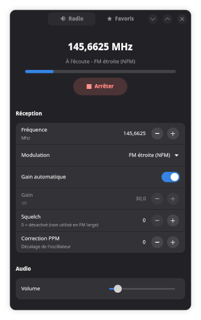

# Radio SDR

Petite interface graphique pour l'écoute avec la clé RTL-SDR (RTL2832U) sur Linux.

<p align="center">
  
</p>

- Démodulation : `rtl_fm` (FM large, FM étroite, AM, BLU USB/LSB)
- Sortie audio : `pacat` vers PipeWire / PulseAudio
- Volume et vumètre gérés en Python (numpy)
- Favoris et réglages enregistrés dans `~/.config/radio-sdr/config.json`

## Installation

### Fedora

```bash
sudo dnf install python3 python3-gobject gtk4 libadwaita python3-numpy rtl-sdr pulseaudio-utils
```

### Debian / Ubuntu

```bash
sudo apt install python3 python3-gi gir1.2-gtk-4.0 gir1.2-adw-1 python3-numpy rtl-sdr pulseaudio-utils
```

## Dépendances

| Rôle                     | Fedora             | Debian / Ubuntu                  |
|--------------------------|--------------------|----------------------------------|
| Python 3                 | `python3`          | `python3`                        |
| Bindings GObject (`gi`)  | `python3-gobject`  | `python3-gi`                     |
| GTK 4                    | `gtk4`             | `gir1.2-gtk-4.0`                 |
| libadwaita (≥ 1.4)       | `libadwaita`       | `gir1.2-adw-1`                   |
| numpy                    | `python3-numpy`    | `python3-numpy`                  |
| `rtl_fm`                 | `rtl-sdr`          | `rtl-sdr`                        |
| `pacat`                  | `pulseaudio-utils` | `pulseaudio-utils`               |

L'application utilise `Adw.ToolbarView`, `Adw.SpinRow` et `Adw.SwitchRow`, qui demandent **libadwaita 1.4 ou plus**.
Il faut donc au minimum **Ubuntu 24.04** ou **Debian 13 (Trixie)**. Debian 12 et Ubuntu 22.04 ont une version trop ancienne.

`pulseaudio-utils` fournit seulement l'outil `pacat`. Il fonctionne aussi avec PipeWire (via `pipewire-pulse`, installé par défaut sur les bureaux récents).

## Configurer la clé RTL-SDR

1. **Le pilote TV (DVB-T) ne doit pas prendre la clé.** Sinon `rtl_fm` affiche
   `usb_claim_interface error`. Le paquet Debian/Ubuntu le bloque déjà. Si le
   problème apparaît (par exemple sur Fedora) :

   ```bash
   echo 'blacklist dvb_usb_rtl28xxu' | sudo tee /etc/modprobe.d/blacklist-rtl-sdr.conf
   sudo modprobe -r dvb_usb_rtl28xxu
   ```

2. **Droits d'accès USB.** Le paquet `rtl-sdr` installe les règles udev. Sur
   Debian/Ubuntu, il faut peut-être aussi ajouter l'utilisateur au groupe
   `plugdev` :

   ```bash
   sudo usermod -aG plugdev "$USER"   # puis se déconnecter et se reconnecter
   ```

3. Débrancher puis rebrancher la clé. Pour vérifier qu'elle est bien vue :

   ```bash
   rtl_test -t
   ```

## Lancement

```bash
./radio.py
# ou
python3 radio.py
```